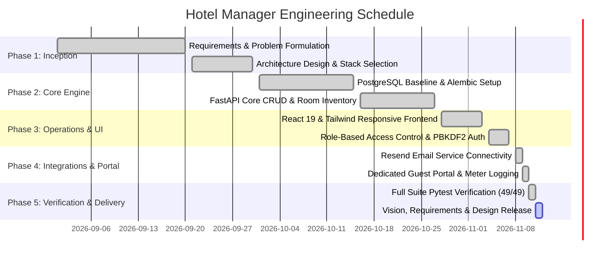
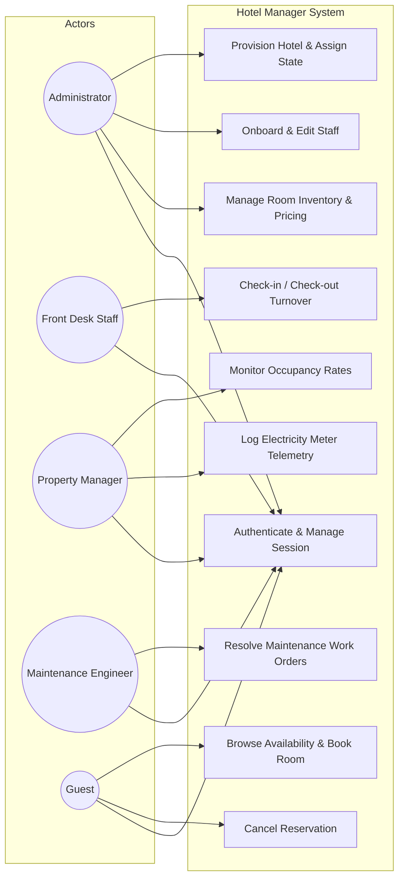
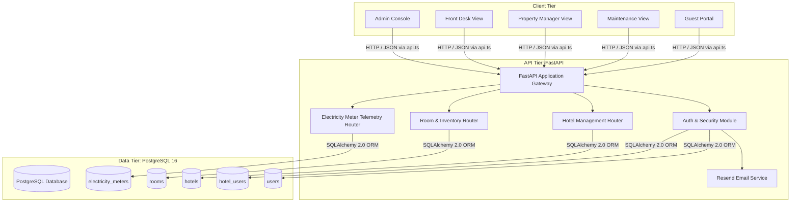
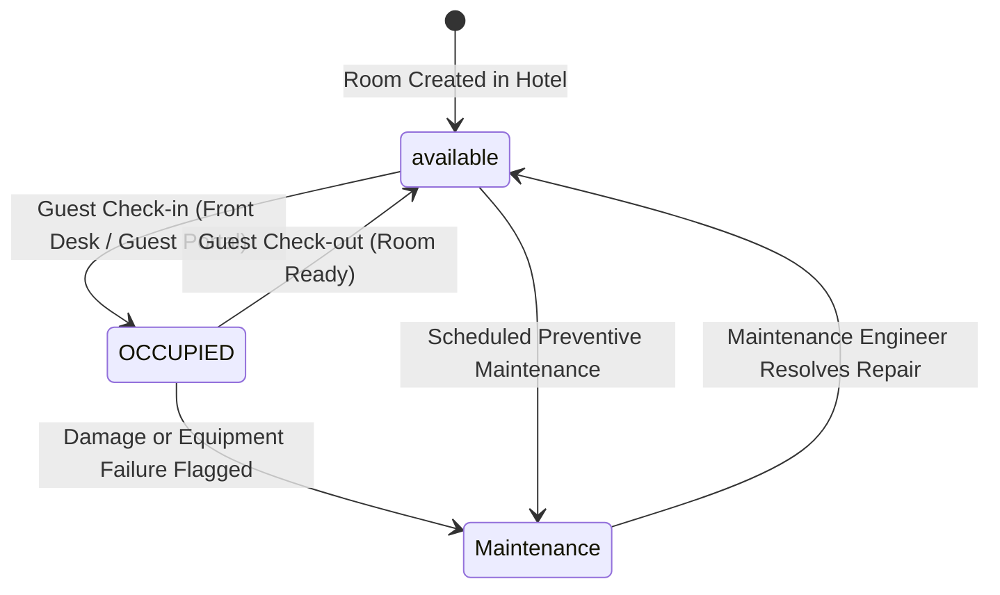
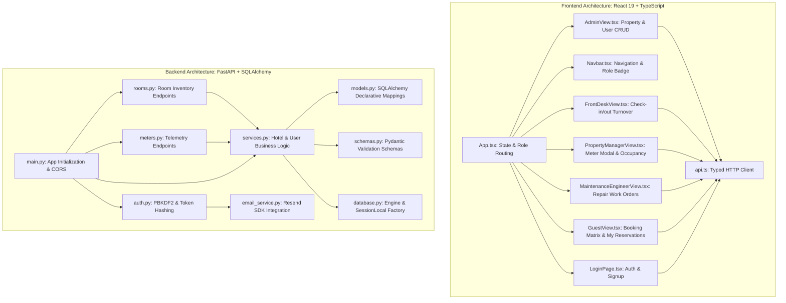
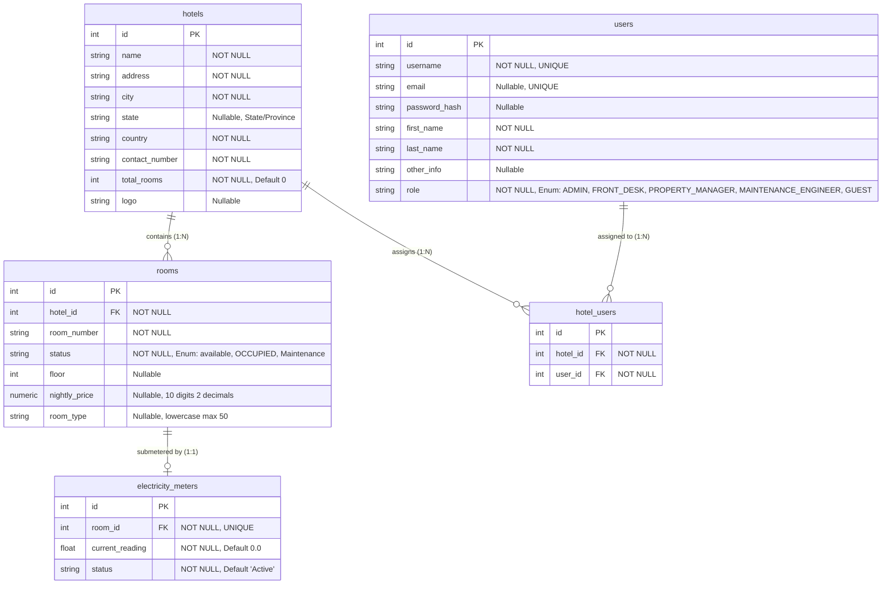
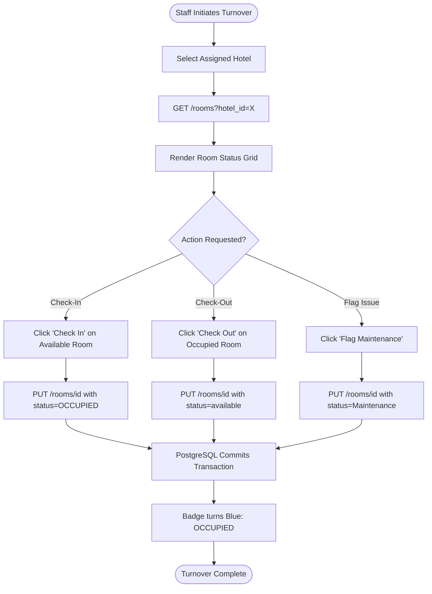
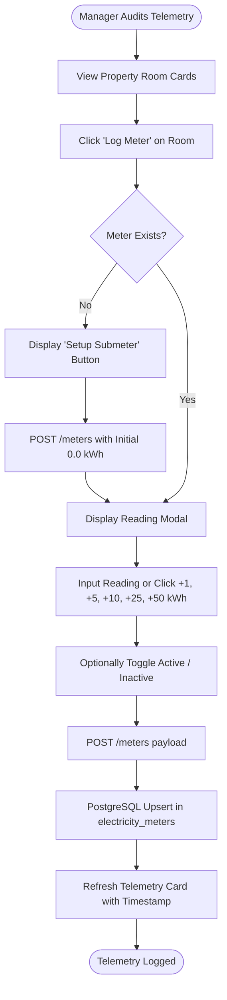
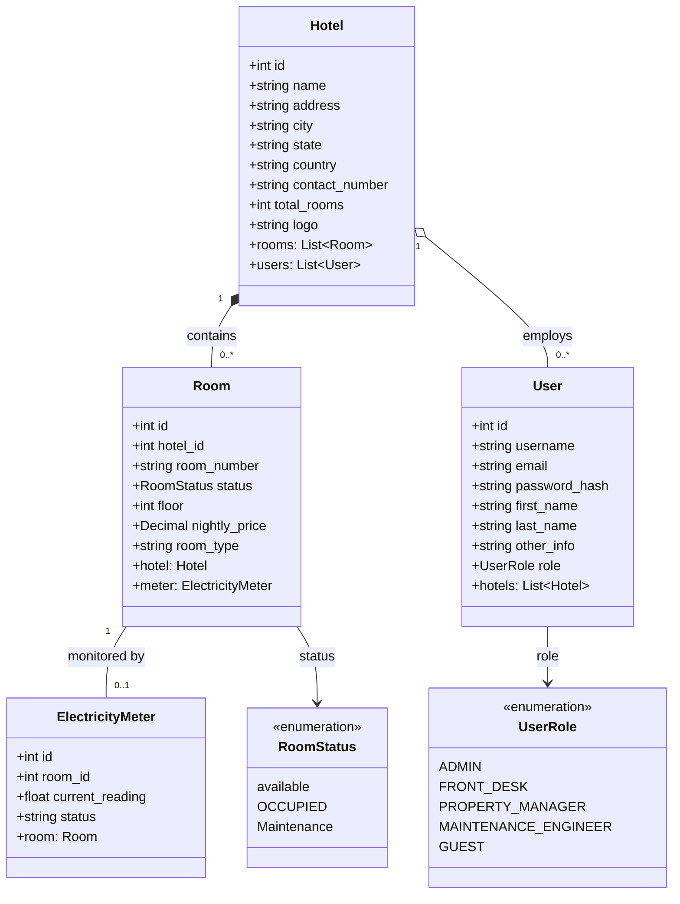

# Project Vision, Requirements, and Design Document

## Hotel Manager Enterprise Property Management System

**Prepared by:**
- Kalel Roscoe
- Shanterrian Walker
- OBrien White
- Jonathan Porter
- KeiShaun Mortis
- Silas Erving

**Academic Metadata:**
- **Institution:** Morehouse College
- **Course Name & Number:** HCSC 460-01 (Senior Capstone)
- **Section & Group:** Group 3
- **Semester:** Fall 2026
- **Date Created:** November 11, 2026
- **Current Version:** 1.0.0

---

## Table of Contents
1. [Revision History](#revision-history)
2. [1. Project Vision and Business Requirements](#1-project-vision-and-business-requirements)
   - [1.1 Background and Business Opportunity](#11-background-and-business-opportunity)
   - [1.2 Business Objectives and Success Criteria](#12-business-objectives-and-success-criteria)
   - [1.3 Project Risks](#13-project-risks)
3. [2. Vision and Scope of the Solution](#2-vision-and-scope-of-the-solution)
   - [2.1 Vision Statement](#21-vision-statement)
   - [2.2 Major Features](#22-major-features)
   - [2.3 Assumptions and Dependencies](#23-assumptions-and-dependencies)
   - [2.4 Scope of Initial Release](#24-scope-of-initial-release)
   - [2.5 Limitations and Exclusions](#25-limitations-and-exclusions)
4. [3. Business Context](#3-business-context)
   - [3.1 Stakeholder Profiles](#31-stakeholder-profiles)
     - [3.1.1 Business Owner](#311-business-owner)
     - [3.1.2 System Users](#312-system-users)
   - [3.2 Project Schedule](#32-project-schedule)
5. [4. Requirements](#4-requirements)
   - [4.1 User Stories](#41-user-stories)
   - [4.2 Use Case Diagram](#42-use-case-diagram)
   - [4.3 Written Use Cases](#43-written-use-cases)
6. [5. Preliminary and Detailed Design](#5-preliminary-and-detailed-design)
   - [5.1 Project Environment](#51-project-environment)
     - [5.1.1 Operating Environment](#511-operating-environment)
     - [5.1.2 System Interactions and Information Flow](#512-system-interactions-and-information-flow)
   - [5.2 Software Modules and Components](#52-software-modules-and-components)
   - [Software Stack](#software-stack)
   - [5.3 Database Design and Schema](#53-database-design-and-schema)
   - [5.4 UML Activity Diagrams](#54-uml-activity-diagrams)
   - [5.5 UML Class Diagrams](#55-uml-class-diagrams)
   - [5.6 Wireframe and UI Architecture Layouts](#56-wireframe-and-ui-architecture-layouts)
7. [6. Appendices](#6-appendices)
   - [6.1 Meeting Minutes](#61-meeting-minutes)
   - [6.2 Other Supporting Documents](#62-other-supporting-documents)

---

## Revision History

| Name | Date | Reason For Changes | Version |
|---|---|---|---|
| Kalel Roscoe & Group 3 | 2026-09-15 | Initial Project Proposal, Core Vision, and Problem Statement | v0.1.0 |
| Shanterrian Walker & OBrien White | 2026-10-10 | Added Room Inventory Domain Model and Alembic Migration Baseline | v0.2.0 |
| Jonathan Porter & KeiShaun Mortis | 2026-10-27 | Implemented Role-Based Access Control, API Endpoints, and Pytest Suite | v0.3.0 |
| Silas Erving & Kalel Roscoe | 2026-11-04 | Added Resend Email integration, Authentication Layer, and Guest Portal | v0.4.0 |
| Group 3 (All Members) | 2026-11-11 | Finalized Architecture to Pure PostgreSQL 16, Complete Requirements & Design Document | v1.0.0 |

---

# 1. Project Vision and Business Requirements

## 1.1 Background and Business Opportunity

The modern hospitality industry spans independent boutique hotels, historic bed-and-breakfasts, and regional hotel chains. While multinational mega-chains rely on multi-million-dollar proprietary property management suites, independent operators face a stark dilemma:
1. **Bloated Legacy Software:** Systems designed decades ago require expensive on-premises servers, rigid multi-year enterprise contracts, and extensive staff onboarding.
2. **Fragmented Niche Tools:** Independent operators often juggle separate applications for front-desk reservations, facility repairs, staff rostering, and utility accounting.
3. **Unmonitored Utility Costs:** Heating, Ventilation, and Air Conditioning (HVAC) accounts for over 60% of a commercial hotel's total energy expenditure. In traditional setups, energy consumption is only discovered at the end of the billing cycle on a consolidated commercial utility bill, making it impossible to identify inefficient rooms, faulty thermal seals, or malfunctioning HVAC compressors in real time.

**Hotel Manager** bridges this divide by delivering a unified, lightweight, and cloud-native **Enterprise Property Management System (PMS)**. By pairing core operational functions (multi-hotel provisioning, instant front-desk turnover, and facilities maintenance dispatch) with an integrated **room-level electricity submetering telemetry engine**, Hotel Manager gives property owners operational clarity, prevents energy waste, and provides guests with a seamless digital booking experience.

## 1.2 Business Objectives and Success Criteria

The primary business objective is to deliver an enterprise-grade, cost-effective PMS that streamlines operational overhead and monitors utility efficiency across multiple properties.

### Quantitative Business Objectives:
- **Turnover Latency Reduction:** Reduce guest check-in and check-out turnaround times by at least **35%**, completing room state transitions in under **2 seconds**.
- **Utility Energy Overhead Savings:** Provide room-level electricity telemetry that enables operators to identify anomalous energy consumption patterns, targeting a **15% to 22% reduction** in unmonitored HVAC energy waste per occupied room.
- **Transactional Reliability:** Maintain **99.9% uptime** for critical operational services with zero data loss, backed by **PostgreSQL 16** ACID transactions and relational foreign key constraints.
- **Low API Latency:** Ensure 95th-percentile (p95) API response times below **100 milliseconds** for standard front-desk queries, room searches, and inventory updates.
- **Code Quality and Automated Verification:** Maintain **100% passing test coverage** across all core service modules, authentication flows, and API endpoints (49 out of 49 automated integration and unit tests passing).

### Success Criteria:
- **Deployment Velocity:** Zero-downtime, automated database schema evolution managed strictly through **Alembic** migrations against PostgreSQL 16.
- **Role Isolation:** Total separation of concerns enforced at both the API layer (PBKDF2-hashed credentials and cryptographically signed session tokens) and the client interface (isolated views for Administrator, Front Desk, Property Manager, Maintenance Engineer, and Guest).
- **User Adoption:** New front desk and maintenance personnel can operate the platform with fewer than **15 minutes of onboarding**, due to responsive percentage-based layout design, clear visual state indicators, and human-readable operational workflows.

## 1.3 Project Risks

| Risk ID | Description | Severity | Likelihood | Mitigation Strategy |
|---|---|---|---|---|
| **RSK-01** | **Multi-Tenant / Property Cross-Talk:** Accidental leakage of guest or room records across distinct hotel properties. | High | Low | Enforce mandatory `hotel_id` foreign keys, query-level scoping in `SQLAlchemy 2.0`, and role-based token validation. |
| **RSK-02** | **Telemetry Ingestion Bottlenecks:** High-frequency meter updates overwhelming backend database connection pools. | Medium | Medium | Implemented unique 1:1 room-to-meter constraints, targeted update semantics (`POST /meters`), and connection pooling with pre-ping validation (`pool_pre_ping=True`). |
| **RSK-03** | **Unauthorized Privilege Escalation:** Non-administrative users attempting to create hotels, alter staff roles, or clear maintenance flags. | High | Low | Token-based role verification (`require_roles` dependencies) on sensitive FastAPI endpoints; frontend routes protected by role-guarded state switches. |
| **RSK-04** | **Third-Party Email Delivery Downtime:** Outages in external transactional email services delaying staff onboarding or welcome notifications. | Low | Medium | Encapsulate email dispatching within resilient try-except blocks using the **Resend SDK**, ensuring operational failures never abort core database transactions. |
| **RSK-05** | **Database Migration Inconsistencies:** Divergence between application ORM models and live PostgreSQL schema tables. | High | Low | Strict CI/CD schema validation; all schema mutations tracked as incremental Alembic revisions (`0001` through `0005`). |

---

# 2. Vision and Scope of the Solution

## 2.1 Vision Statement

> **"For multi-property hospitality operators, facility engineers, front desk staff, and guests who require frictionless property administration and sustainable operations, Hotel Manager is an integrated, full-stack Property Management System. Unlike fragmented, expensive legacy hospitality platforms, Hotel Manager unites real-time room inventory turnover, multi-hotel administrative provisioning, role-isolated operational consoles, and electrical submetering telemetry within a unified, high-performance web platform."**

## 2.2 Major Features

1. **Multi-Property Provisioning & Administration:**
   - Centralized management of hotel properties across multiple cities, states/provinces, and countries.
   - Dynamic hotel capacity calculation, address tracking, and staff roster assignment.
2. **Authenticated Role-Based Access Control (RBAC):**
   - Secure credential hashing using **PBKDF2-HMAC-SHA256** (100,000 iterations).
   - Tamper-proof HMAC SHA-256 session access tokens.
   - Distinct, isolated user roles: `Administrator`, `Front Desk`, `Property Manager`, `Maintenance Engineer`, and `Guest`.
3. **Rapid Front-Desk Room Turnover:**
   - Real-time room status matrix (`available`, `OCCUPIED`, `Maintenance`).
   - One-click check-in and check-out workflows with immediate visual state feedback.
4. **Room Inventory & Multivariable Filtering:**
   - Support for floor numbers, nightly room pricing, room types (`single`, `double`, `suite`, `deluxe`), and operational status.
   - Composable multi-parameter search API with inclusive price range bounds and pagination.
5. **Electricity Submeter Telemetry & Utility Accounting:**
   - 1:1 association between guest rooms and dedicated electricity submeters.
   - In-app telemetry logging console with quick-add increments (`+1`, `+5`, `+10`, `+25`, `+50` kWh), active/inactive status toggles, and zero-friction setup for unmetered rooms.
6. **Facilities & Maintenance Work Order Queue:**
   - Automated routing of rooms flagged as `Maintenance` to engineering staff.
   - Telemetry diagnostics and one-click repair resolution returning rooms to `available`.
7. **Guest Reservation Portal:**
   - Public-facing self-service booking flow restricted to authenticated guest accounts.
   - Real-time stay calculation, total rate projection, automated confirmation code generation (`HM-XXXXXX`), and guest reservation cancellation.
8. **Transactional Email Connectivity:**
   - Direct integration with **Resend SDK** for onboarding notifications and test verification.

### Feature Decomposition Tree

```mermaid
graph TD
    HM[Hotel Manager Platform]
    
    HM --> ADM[Administration]
    ADM --> ADM_H[Hotel Provisioning & State Tracking]
    ADM --> ADM_S[Staff Onboarding & Password Management]
    ADM --> ADM_R[Inventory Management & Room Pricing]
    
    HM --> AUTH[Security & Auth Layer]
    AUTH --> AUTH_H[PBKDF2-HMAC-SHA256 Hashing]
    AUTH --> AUTH_T[HMAC Token Session Management]
    AUTH --> AUTH_R[5-Tier Role Isolation]
    
    HM --> OPS[Operations & Front Desk]
    OPS --> OPS_CI[1-Click Guest Check-In]
    OPS --> OPS_CO[1-Click Guest Check-Out]
    OPS --> OPS_ST[Live Room Status Synchronization]
    
    HM --> TEL[Telemetry & Facilities]
    TEL --> TEL_M[Electricity Meter In-App Logging]
    TEL --> TEL_E[Sensible Heat & Energy Calculations]
    TEL --> TEL_WO[Maintenance Work Order Queue]
    
    HM --> GST[Guest Portal]
    GST --> GST_B[Multi-Property Room Booking]
    GST --> GST_C[Instant HM Confirmation Codes]
    GST --> GST_R[My Reservations & Cancellation]
```



## 2.3 Assumptions and Dependencies

### System Assumptions:
1. **Single Primary Database Engine:** The production and development backend relies exclusively on **PostgreSQL 16**.
2. **Submeter Ingestion Units:** All electric submeter readings are ingested and stored as non-negative floating-point values representing cumulative **kilowatt-hours (kWh)**.
3. **Room Dimensions and HVAC Constants:** Standard sensible heat load equations assume standard sea-level air density ($1.08 \text{ BTU}/(\text{hr} \cdot \text{CFM} \cdot ^\circ\text{F})$).

### Technical Dependencies:
- **Backend Runtime:** Python 3.11+ / Python 3.14+
- **API Framework:** FastAPI 0.115+
- **ORM & Data Layer:** SQLAlchemy 2.0+ with Psycopg 3 (`postgresql+psycopg`)
- **Database Engine:** PostgreSQL 16 (executed via Docker Compose or managed cloud database)
- **Database Migrations:** Alembic 1.13+
- **Email Gateway:** Resend Python SDK
- **Frontend Framework:** React 19, TypeScript 5.7+
- **Bundler & Tooling:** Vite 6+
- **CSS Architecture:** Tailwind CSS v4 with CSS Flex wrapping and percentage-based sizing
- **Iconography:** Lucide React

### Mathematical & Engineering Telemetry Models:

For rooms undergoing thermodynamic and electrical audits, sensible heat gain ($Q_s$) and associated electrical cooling costs are calculated using standard ASHRAE thermodynamic equations:

#### Sensible Heat Gain Formula:
$$Q_s [\text{BTU/hr}] = 1.08 \times (\text{CFM}) \times \Delta T$$

Where:
- $\Delta T = T_f - T_0$ is the temperature difference between outdoor ambient temperature ($T_0$) and desired indoor room temperature ($T_f$) in degrees Fahrenheit ($^\circ\text{F}$).
- $\text{CFM}$ (Cubic Feet per Minute) represents the room volume airflow rate:
$$\text{CFM} = (l \times w \times h) \times 60 \frac{\text{min}}{\text{hr}}$$
  where $l, w, h$ are the room's length, width, and ceiling height in feet.

#### Energy Cost Conversion:
Using the thermodynamic conversion factor $1 \text{ BTU/hr} = 0.000293071 \text{ kW}$:

$$\text{Cost/hr} = Q_s [\text{BTU/hr}] \times 0.000293071 \left[\frac{\text{kW}}{\text{BTU/hr}}\right] \times \text{Cost per kWh} [\$]$$

$$\text{Cost/day} = \text{Cost/hr} \times 24 \frac{\text{hr}}{\text{day}}$$

These formulas provide the analytical baseline for comparing theoretical HVAC energy demand against empirical electricity submeter readings stored in the `electricity_meters` database table.

## 2.4 Scope of Initial Release

The initial release (v1.0.0) delivers:
- Fully functional multi-hotel provisioning, room management, and user binding.
- PBKDF2-secured user signup and login portal with automatic role routing.
- Dedicated operational dashboards for Administrators, Front Desk Staff, Property Managers, and Maintenance Engineers.
- Dedicated self-service Guest Portal with live availability, booking, and cancellation.
- In-app modal for electricity submeter logging, status switching, and rapid increment adjustments.
- Transactional email dispatch via Resend.
- Containerized PostgreSQL 16 deployment via Docker Compose with automated Alembic migrations.

## 2.5 Limitations and Exclusions

The following capabilities are deliberately excluded from v1.0.0 and slated for future milestone releases:
- **Payment Processing Gateways:** Direct credit card tokenization or merchant processing (e.g., Stripe, Adyen). Bookings in v1.0 record reservation commitments without processing live monetary transactions.
- **Physical Keycard Hardware Interfacing:** Direct communication with on-premises RFID door lock encoders (e.g., ASSA ABLOY, Dormakaba).
- **Automated IoT Hardware Ingestion:** Real-time BACnet or MQTT sensor streaming; electricity readings in v1.0 are logged via the Property Manager telemetry console.
- **Multi-Language Internationalization (i18n):** The initial release interface is localized in US English.

---

# 3. Business Context

## 3.1 Stakeholder Profiles

### 3.1.1 Business Owner
- **Role:** Hotel Owner, Hospitality Franchisee, General Manager.
- **Primary Concerns:** Operational visibility across hotel properties, reduction of overhead costs (specifically utility and energy bills), maximizing room occupancy rates, and preventing duplicate bookings or unaddressed maintenance issues.
- **Expectations:** A centralized web interface requiring zero local server maintenance, offering instant multi-property oversight and reliable data persistence.

### 3.1.2 System Users

| User Persona | Role Identifier | Operational Responsibilities | Primary Interface Needs |
|---|---|---|---|
| **System Administrator** | `ADMIN` | Provisions new hotel properties, assigns addresses and states, manages staff credentials, sets room inventories and nightly rates. | High-density data tables, modal forms, searchable hotel directory, staff password resets. |
| **Front Desk Staff** | `FRONT_DESK` | Manages day-to-day guest arrivals, departures, and room availability. | Clean, visual room status grid (`available`, `OCCUPIED`, `Maintenance`), one-click check-in/out buttons. |
| **Property Manager** | `PROPERTY_MANAGER` | Audits property occupancy percentages, inspects utility consumption, logs room electricity meter readings. | Occupancy summary cards, meter reading modal with rapid increment buttons, telemetry audit log. |
| **Maintenance Engineer** | `MAINTENANCE_ENGINEER` | Diagnoses mechanical and electrical issues in guest rooms, executes repair orders. | Dedicated work order backlog, room equipment status, one-click repair sign-off. |
| **Hotel Guest** | `GUEST` | Browses room availability across hotels, books stays, views active reservation confirmation codes. | Responsive self-service booking portal, date/pricing calculator, reservation management. |

## 3.2 Project Schedule



---

# 4. Requirements

## 4.1 User Stories

### Administrator Stories
- **US-ADM-01:** *As an Administrator, I want to create a new hotel with state/province, city, and room capacity details, so that my business can onboard new properties into the PMS.*
- **US-ADM-02:** *As an Administrator, I want to onboard staff members with designated roles and initial passwords, so that employees can securely access their role-specific workflows.*
- **US-ADM-03:** *As an Administrator, I want to edit existing staff user accounts (names, roles, status, and reset passwords), so that staffing changes are maintained accurately.*
- **US-ADM-04:** *As an Administrator, I want to add rooms with floor numbers, room types, and nightly pricing, so that our inventory is fully configured for booking.*

### Front Desk Stories
- **US-FD-01:** *As a Front Desk Agent, I want to see a live visual grid of all rooms in my assigned hotel, so that I can immediately determine which rooms are available, occupied, or undergoing maintenance.*
- **US-FD-02:** *As a Front Desk Agent, I want to check in an arriving guest with a single click, so that room turnover latency is minimized during peak arrival windows.*
- **US-FD-03:** *As a Front Desk Agent, I want to check out a departing guest, so that the room is immediately freed for cleaning or made available for subsequent reservations.*

### Property Manager Stories
- **US-PM-01:** *As a Property Manager, I want to view live occupancy rates across my property, so that I can evaluate daily business performance.*
- **US-PM-02:** *As a Property Manager, I want to record electricity meter readings in kWh using quick increment buttons, so that utility telemetry can be logged without data-entry friction.*
- **US-PM-03:** *As a Property Manager, I want to initialize electricity submeters on unmetered rooms directly from the interface, so that telemetry tracking covers all physical units.*

### Maintenance Engineer Stories
- **US-MNT-01:** *As a Maintenance Engineer, I want a dedicated queue showing only rooms flagged with `Maintenance`, so that my team can prioritize urgent facility repairs.*
- **US-MNT-02:** *As a Maintenance Engineer, I want to inspect electricity meter status on flagged rooms, so that I can diagnose electrical or HVAC equipment anomalies.*
- **US-MNT-03:** *As a Maintenance Engineer, I want to click a single "Complete Repair" button to return a room to `available`, so that the front desk knows the room is ready for occupancy.*

### Guest Stories
- **US-GST-01:** *As a Guest, I want to browse available rooms across multiple hotel locations with pricing and room types, so that I can select an ideal stay.*
- **US-GST-02:** *As a Guest, I want to book a room for my specified dates and receive an instant confirmation code (`HM-XXXXXX`), so that my reservation is verified.*
- **US-GST-03:** *As a Guest, I want to view my active reservations and cancel a booking if my travel plans change, so that my reservation itinerary remains up to date.*

## 4.2 Use Case Diagram



## 4.3 Written Use Cases

### Use Case UC-01: Multi-Hotel Provisioning & Staff Onboarding
- **Primary Actor:** Administrator
- **Preconditions:** Administrator is logged in with valid session token and `role == 'ADMIN'`.
- **Trigger:** Administrator clicks "Create Hotel" or "Manage Property" ➔ "Add Staff".
- **Main Success Scenario:**
  1. Administrator completes the hotel form including Hotel Name, Address, City, State/Province, Country, Contact Number, and Total Rooms.
  2. System validates payload against `HotelCreate` Pydantic schema.
  3. Backend inserts row into `hotels` table in PostgreSQL and returns HTTP 201 Created.
  4. Administrator opens hotel management modal and selects "Add Staff".
  5. Administrator inputs staff username, email, full name, role (`FRONT_DESK`, `PROPERTY_MANAGER`, or `MAINTENANCE_ENGINEER`), and initial password.
  6. Backend hashes password using PBKDF2-HMAC-SHA256, stores user in `users`, binds user in `hotel_users`, and triggers Resend welcome email.
- **Extensions:**
  - *Invalid / Duplicate Username or Email:* Backend returns HTTP 400 with descriptive error message; modal preserves inputs and alerts user.

### Use Case UC-02: Guest Check-in & Rapid Room Turnover
- **Primary Actor:** Front Desk Staff
- **Preconditions:** User is authenticated with `role == 'FRONT_DESK'` and assigned to the active hotel.
- **Trigger:** Guest arrives at front desk to check in or depart.
- **Main Success Scenario:**
  1. Front Desk staff views the live room status grid for their property.
  2. For check-in: Staff locates an `available` room and clicks "Check In".
  3. System issues `PUT /rooms/{id}` with `status: "OCCUPIED"`.
  4. Backend executes update within a PostgreSQL transaction and returns updated room record.
  5. Room badge transitions dynamically to blue (`OCCUPIED`).
  6. For check-out: Staff clicks "Check Out"; status transitions to `available`.
- **Extensions:**
  - *Room Requires Maintenance:* Staff flags room as `Maintenance`; room is immediately removed from available inventory and routed to the Maintenance Engineer backlog.

### Use Case UC-03: Electricity Submeter Telemetry Logging
- **Primary Actor:** Property Manager
- **Preconditions:** User is authenticated with `role == 'PROPERTY_MANAGER'`.
- **Trigger:** Property Manager audits room electricity consumption or performs daily utility checks.
- **Main Success Scenario:**
  1. Property Manager views the property dashboard and selects "Log Meter" on a room card.
  2. System checks `GET /rooms/{id}/meter`. If unmetered, displays "Initialize Submeter" button.
  3. Modal displays current reading in kWh and status (Active/Inactive).
  4. Property Manager enters updated cumulative reading or uses quick-increment buttons (`+1`, `+5`, `+10`, `+25`, `+50` kWh).
  5. Property Manager submits reading via `POST /meters`.
  6. Backend verifies room existence, performs an atomic upsert on `electricity_meters` in PostgreSQL, and returns HTTP 200/201.
  7. Client updates room card with latest telemetry reading and audit timestamp.

### Use Case UC-04: Maintenance Work Order Resolution
- **Primary Actor:** Maintenance Engineer
- **Preconditions:** User is authenticated with `role == 'MAINTENANCE_ENGINEER'`.
- **Trigger:** Facilities team member logs in to inspect daily repair backlog.
- **Main Success Scenario:**
  1. System queries `GET /rooms?status=Maintenance` and populates the Maintenance Work Orders table.
  2. Engineer reviews room number, floor, room type, and associated electrical submeter reading.
  3. Engineer physically repairs room facilities (HVAC, plumbing, electrical).
  4. Engineer clicks "Resolve / Complete Repair".
  5. System sends `PUT /rooms/{id}` setting `status` to `available`.
  6. Room disappears from work order queue and reappears on the Front Desk grid as available inventory.

### Use Case UC-05: Guest Room Reservation & Self-Service Cancellation
- **Primary Actor:** Guest
- **Preconditions:** User is authenticated with `role == 'GUEST'`.
- **Trigger:** Guest navigates to the Guest Portal.
- **Main Success Scenario:**
  1. Guest selects destination hotel, desired room type (`Single`, `Double`, `Suite`, `Deluxe`), and stay dates.
  2. Portal dynamically queries available rooms and displays nightly rate and computed total.
  3. Guest enters special requests and clicks "Confirm Reservation".
  4. System locks room by transitioning status to `OCCUPIED` and generates a persistent confirmation code (`HM-` followed by 6 random alphanumeric characters).
  5. Confirmation modal presents complete itinerary and receipt summary.
  6. Reservation appears under guest's "My Reservations" tab.
  7. If guest clicks "Cancel Reservation", system confirms intent, frees the room back to `available`, and clears the booking.

---

# 5. Preliminary and Detailed Design

## 5.1 Project Environment

### 5.1.1 Operating Environment
- **Distribution:** Distributed client-server web architecture. The backend API is hosted in containerized Linux environments (Docker / Cloud VM), while the client application runs on modern standards-compliant web browsers (Chrome, Firefox, Safari, Edge).
- **Time Zones & Concurrency:** All internal system timestamps are stored in UTC ISO 8601 format. Optimistic and row-level locking in PostgreSQL ensures zero data corruption during simultaneous front-desk check-ins.
- **Data Protection & Security:**
  - Password credentials hashed with salt via PBKDF2-HMAC-SHA256 (100,000 rounds).
  - Bearer access tokens signed with HMAC SHA-256 containing expiration, user ID, role, and assigned hotel ID.
  - Foreign key constraints with `ON DELETE RESTRICT` on rooms with meters to prevent accidental orphaned telemetry records.

### 5.1.2 System Interactions and Information Flow



### Room Lifecycle State Chart



## 5.2 Software Modules and Components



## Software Stack

| Tier / Component | Technology | Version | Purpose |
|---|---|---|---|
| **Database** | PostgreSQL | 16.x | Primary relational database with ACID guarantees, foreign keys, and indexes. |
| **Backend Framework** | FastAPI | 0.115+ | High-performance asynchronous REST API framework. |
| **ORM Layer** | SQLAlchemy | 2.0+ | Object-relational mapping, transaction control, query construction. |
| **DB Driver** | Psycopg 3 | 3.2+ | Native high-speed PostgreSQL driver (`postgresql+psycopg`). |
| **Schema Migrations** | Alembic | 1.13+ | Version-controlled, declarative database schema migrations. |
| **Validation** | Pydantic | v2.9+ | Strict input validation, data parsing, serialization schemas. |
| **Authentication** | PBKDF2 / HMAC | SHA-256 | Cryptographic password hashing and tamper-proof session tokens. |
| **Email Service** | Resend SDK | 2.6+ | Cloud transactional email delivery for onboarding and testing. |
| **Testing** | Pytest / TestClient | 9.1+ / 0.115+ | Automated unit and integration test suite (49 passing tests). |
| **Frontend Framework** | React | 19.x | Declarative component UI library. |
| **Language** | TypeScript | 5.7+ | End-to-end static type safety and contract enforcement. |
| **Build Tool** | Vite | 6.x | Modern frontend development server and production bundler. |
| **Styling** | Tailwind CSS | 4.x | Fluid percentage-based layout, modern utility CSS styling. |
| **Icons** | Lucide React | Latest | Consistent modern UI iconography. |

## 5.3 Database Design and Schema



### Database Tables and Column Definitions:

1. **`hotels` Table:**
   - `id`: `INTEGER`, Primary Key, Auto-increment.
   - `name`: `VARCHAR`, Not Null. Legal trade name of hotel.
   - `address`: `VARCHAR`, Not Null. Physical street address.
   - `city`: `VARCHAR`, Not Null. Municipality.
   - `state`: `VARCHAR`, Nullable. Added via Migration `0005` to capture US states or international provinces.
   - `country`: `VARCHAR`, Not Null. Country name.
   - `contact_number`: `VARCHAR`, Not Null. Central front desk telephone.
   - `total_rooms`: `INTEGER`, Not Null, Default 0. Total physical room count.
   - `logo`: `VARCHAR`, Nullable. Optional URL or asset path to brand logo.

2. **`rooms` Table:**
   - `id`: `INTEGER`, Primary Key, Auto-increment.
   - `hotel_id`: `INTEGER`, Foreign Key referencing `hotels.id`, Not Null.
   - `room_number`: `VARCHAR`, Not Null.
   - `status`: `VARCHAR`, Not Null, Constrained to `'available'`, `'OCCUPIED'`, `'Maintenance'`.
   - `floor`: `INTEGER`, Nullable. Added via Migration `0002`.
   - `nightly_price`: `NUMERIC(10, 2)`, Nullable. Added via Migration `0002`.
   - `room_type`: `VARCHAR(50)`, Nullable. Added via Migration `0002`.

3. **`users` Table:**
   - `id`: `INTEGER`, Primary Key, Auto-increment.
   - `username`: `VARCHAR`, Not Null, Unique index.
   - `email`: `VARCHAR`, Nullable, Unique index. Added via Migration `0004`.
   - `password_hash`: `VARCHAR`, Nullable. PBKDF2 hash. Added via Migration `0004`.
   - `first_name`: `VARCHAR`, Not Null.
   - `last_name`: `VARCHAR`, Not Null.
   - `other_info`: `VARCHAR`, Nullable.
   - `role`: `VARCHAR`, Not Null. Enforced via `UserRole` Enum (`ADMIN`, `FRONT_DESK`, `PROPERTY_MANAGER`, `MAINTENANCE_ENGINEER`, `GUEST`).

4. **`hotel_users` Table:**
   - `id`: `INTEGER`, Primary Key, Auto-increment.
   - `hotel_id`: `INTEGER`, Foreign Key referencing `hotels.id`, Not Null.
   - `user_id`: `INTEGER`, Foreign Key referencing `users.id`, Not Null.

5. **`electricity_meters` Table:**
   - `id`: `INTEGER`, Primary Key, Auto-increment.
   - `room_id`: `INTEGER`, Foreign Key referencing `rooms.id`, Not Null, Unique constraint.
   - `current_reading`: `FLOAT`, Not Null, Default 0.0. Cumulative kWh consumption.
   - `status`: `VARCHAR`, Not Null, Default `'Active'`. Constrained to `'Active'` or `'Inactive'`.

## 5.4 UML Activity Diagrams

### Front Desk Check-in / Check-out Activity Flow



### Electricity Submeter In-App Telemetry Flow



## 5.5 UML Class Diagrams



## 5.6 Wireframe and UI Architecture Layouts

The frontend utilizes a modern, percentage-based responsive layout with flex wrapping to maintain fixed container geometries across varying viewport resolutions:

### 1. Authentication Portal (`/login`)
```text
+------------------------------------------------------------------+
|                      [ HOTEL MANAGER PMS ]                       |
|           Welcome back. Please sign in to your account.          |
+------------------------------------------------------------------+
|  [ Username or Email Address: __________________________ ]       |
|  [ Account Password:          __________________________ ]       |
|                                                                  |
|  [       Sign In to Dashboard (Authenticated Access)     ]       |
+------------------------------------------------------------------+
|  Need an account? [ Switch to Register / Sign Up ]               |
|  (New users and Administrators can create registered accounts)   |
+------------------------------------------------------------------+
```

### 2. Administrator Console (`AdminView`)
```text
+------------------------------------------------------------------+
| HOTEL MANAGER | Admin Console | Logged in as: admin  | [Log Out] |
+------------------------------------------------------------------+
| Property Directory                       [ + Create New Hotel ]  |
| Search: [ Find hotel by name, city...   ]                        |
+------------------------------------------------------------------+
| Hotel Name       | City, State       | Total Rooms | Actions     |
+------------------+-------------------+-------------+-------------+
| Grand Plaza      | Atlanta, GA       | 120 rooms   | [ Manage ]  |
| Sunset Suites    | Savannah, GA      | 45 rooms    | [ Manage ]  |
+------------------------------------------------------------------+
| [Manage Modal]: Property Info | Staff Directory | Add Room | Edit|
|   Staff Roster:                                                  |
|   - Jane Doe (Front Desk)         [ Edit ] [ Send Test Email ]   |
|   - Bob Smith (Property Mgr)      [ Edit ] [ Send Test Email ]   |
+------------------------------------------------------------------+
```

### 3. Front Desk Operations (`FrontDeskView`)
```text
+------------------------------------------------------------------+
| HOTEL MANAGER | Front Desk | Hotel: Grand Plaza      | [Log Out] |
+------------------------------------------------------------------+
| Quick Stats: [ 85 Available ]  [ 30 Occupied ]  [ 5 Maintenance] |
+------------------------------------------------------------------+
| Filter: [ All ] [ Available ] [ Occupied ] [ Maintenance ]       |
+------------------------------------------------------------------+
| [ Room 101 ]      | [ Room 102 ]      | [ Room 103 ]             |
| Type: Double      | Type: Suite       | Type: Single             |
| Rate: $120.00     | Rate: $210.00     | Rate: $95.00             |
| Status: AVAILABLE | Status: OCCUPIED  | Status: MAINTENANCE      |
| [ Check In ]      | [ Check Out ]     | [ In Repair ]            |
+------------------------------------------------------------------+
```

### 4. Property Manager Telemetry & Occupancy (`PropertyManagerView`)
```text
+------------------------------------------------------------------+
| HOTEL MANAGER | Property Manager | Grand Plaza       | [Log Out] |
+------------------------------------------------------------------+
| Occupancy Rate: 71.4%  | Active Submeters: 118/120               |
+------------------------------------------------------------------+
| [ Room 101 Telemetry Card ]                                      |
| Status: OCCUPIED | Submeter #401: 1,420.50 kWh [Active]          |
| [ Log Meter Reading (In-App Modal) ]                             |
|                                                                  |
|   +----------------------------------------------------+         |
|   | Update Meter Reading - Room 101                    |         |
|   | Current: [ 1420.50 ] kWh                           |         |
|   | Quick Add: [ +1 ] [ +5 ] [ +10 ] [ +25 ] [ +50 ]   |         |
|   | Status: [X] Active  [ ] Inactive                   |         |
|   | [ Cancel ]                         [ Save Reading] |         |
|   +----------------------------------------------------+         |
+------------------------------------------------------------------+
```

### 5. Dedicated Guest Self-Service Portal (`GuestView`)
```text
+------------------------------------------------------------------+
| HOTEL MANAGER | Guest Reservations | Guest: Kalel R. | [Log Out] |
+------------------------------------------------------------------+
| [ Browse Available Stays ]         [ My Reservations (1 Active) ]|
+------------------------------------------------------------------+
| Destination Hotel: [ Grand Plaza, Atlanta, GA ▼ ]                |
| Room Category:     [ Deluxe King Suite ($240.00/night) ▼ ]       |
| Length of Stay:    [ 3 Nights ]                                  |
| Total Estimated:   $720.00                                       |
| Special Requests:  [ High floor, quiet room requested...       ] |
|                                                                  |
| [               Confirm and Book Reservation                  ]  |
+------------------------------------------------------------------+
| Active Booking: Conf Code # HM-78F9B2                            |
| Grand Plaza - Room 402 (Deluxe King) - 3 Nights                  |
| Status: Confirmed                            [ Cancel Booking ]  |
+------------------------------------------------------------------+
```

---

# 6. Appendices

## 6.1 Meeting Minutes

### Group 3 Meeting 1: Inception and Architecture Selection
- **Date & Location:** September 15, 2026 – Morehouse College Computer Science Laboratory (Room 214)
- **Attendees:** Kalel Roscoe, Shanterrian Walker, OBrien White, Jonathan Porter, KeiShaun Mortis, Silas Erving.
- **Agenda:** Capstone project ideation, domain analysis, technology stack election.
- **Discussion Summary:** The team reviewed conventional property management pain points and identified the absence of real-time electricity telemetry as a major unsolved problem for independent hotels. The team elected Python (FastAPI) for high performance and typing ergonomics, paired with PostgreSQL 16 for ACID compliance and React 19 for a modular user interface.
- **Action Items:**
  - Kalel & Shanterrian: Outline core database schema and draft Alembic migration baseline.
  - Jonathan & OBrien: Scaffold FastAPI application and Pydantic schemas.
  - KeiShaun & Silas: Research ASHRAE thermodynamic equations for sensible heat gain telemetry.

### Group 3 Meeting 2: Inventory Schema & Migration Engineering
- **Date & Location:** October 10, 2026 – Virtual Sync (Google Meet)
- **Attendees:** Kalel Roscoe, Shanterrian Walker, OBrien White, Jonathan Porter, KeiShaun Mortis, Silas Erving.
- **Agenda:** Room inventory domain extension, floor tracking, nightly pricing decimal validation, and Alembic versioning.
- **Discussion Summary:** Finalized migration `0002` adding `floor`, `nightly_price`, and `room_type` to `rooms`. Resolved decimal rounding constraints by storing currency in `NUMERIC(10, 2)` and serializing values as exact JSON strings to prevent floating-point inaccuracies.
- **Action Items:**
  - Shanterrian & OBrien: Author Alembic migration scripts and add integration tests for combined filtering.
  - Kalel & Jonathan: Implement multi-filter search queries with inclusive bounds.

### Group 3 Meeting 3: Security Hardening, Resend Email & Guest Portal
- **Date & Location:** November 04, 2026 – Morehouse College Library Study Suite 3B
- **Attendees:** Kalel Roscoe, Shanterrian Walker, OBrien White, Jonathan Porter, KeiShaun Mortis, Silas Erving.
- **Agenda:** Replacing unauthenticated mock logins with PBKDF2 hashing, integrating Resend for transactional email, building dedicated Guest portal.
- **Discussion Summary:** Replaced legacy instant access shortcuts with an authenticated login and signup workflow. Created `hotel_manager.auth` with PBKDF2-HMAC-SHA256 and HMAC token verification. Created `hotel_manager.email_service` backed by the Resend SDK. Designed `GuestView.tsx` exclusively for users with role `GUEST`.
- **Action Items:**
  - Silas & KeiShaun: Connect Resend SDK with API endpoints and create test email dispatchers.
  - Kalel & Group: Verify all 49 pytest test cases pass and update project documentation.

## 6.2 Other Supporting Documents

### Complete API Surface Reference

| Method | Path | Auth / Roles Required | Description |
|---|---|---|---|
| `GET` | `/` | Public | Service health verification (`{"service": "hotel-manager", "status": "ok"}`) |
| `POST` | `/auth/signup` | Public | Register new user or administrator account |
| `POST` | `/auth/login` | Public | Authenticate with credentials; returns HMAC access token |
| `GET` | `/auth/me` | Authenticated | Retrieve profile and assigned hotel for current session token |
| `POST` | `/hotels` | `ADMIN` | Provision new hotel record (includes `state` / province) |
| `GET` | `/hotels` | Authenticated | Paginated hotel directory listing |
| `GET` | `/hotels/{id}` | Authenticated | Retrieve specific hotel metadata |
| `PUT` | `/hotels/{id}` | `ADMIN` | Update hotel metadata (name, address, city, state, capacity) |
| `DELETE` | `/hotels/{id}` | `ADMIN` | Remove hotel and associated inventory |
| `POST` | `/rooms` | `ADMIN` | Add room to hotel inventory |
| `GET` | `/rooms` | Authenticated | Multi-variable room search (`hotel_id`, `status`, `floor`, `room_type`, `min_price`, `max_price`) |
| `GET` | `/rooms/{id}` | Authenticated | Retrieve specific room record |
| `PUT` | `/rooms/{id}` | `ADMIN`, `FRONT_DESK`, `MAINTENANCE_ENGINEER` | Update room properties or transition status (`available`, `OCCUPIED`, `Maintenance`) |
| `DELETE` | `/rooms/{id}` | `ADMIN` | Delete room record (restricted if meter is attached) |
| `POST` | `/users` | `ADMIN` | Create user with PBKDF2 password and hotel binding |
| `GET` | `/users` | `ADMIN` | Paginated user roster with role filtering |
| `PUT` | `/users/{id}` | `ADMIN` | Update staff details, change roles, or reset account password |
| `DELETE` | `/users/{id}` | `ADMIN` | Remove user record |
| `POST` | `/hotels/{h_id}/users/{u_id}/bind` | `ADMIN` | Bind staff member to specific hotel property |
| `POST` | `/meters` | `ADMIN`, `PROPERTY_MANAGER` | Create or update cumulative electricity meter reading (kWh) |
| `GET` | `/meters` | Authenticated | List all active and inactive electricity submeters |
| `GET` | `/rooms/{id}/meter` | Authenticated | Retrieve current electricity telemetry reading for a room |
| `DELETE` | `/meters/{id}` | `ADMIN` | Delete electricity meter record |
| `POST` | `/email/send-test` | `ADMIN` | Dispatch test notification via Resend SDK |

### Local PostgreSQL Deployment Guide

To deploy the production-ready PostgreSQL environment locally:

```bash
# 1. Start PostgreSQL 16 container in background
docker compose -f local/postgres/docker-compose.yml up -d

# 2. Verify PostgreSQL container readiness
docker exec capstone-postgres pg_isready -U capstone -d capstone

# 3. Synchronize Python virtual environment
uv sync

# 4. Apply all declarative database migrations
uv run alembic upgrade head

# 5. Start the FastAPI application server
uv run fastapi dev src/hotel_manager/main.py

# 6. In a separate terminal, launch the React 19 frontend
npm run dev
```

The web application is accessible at `http://localhost:3000` with API documentation available at `http://127.0.0.1:8000/docs`.
